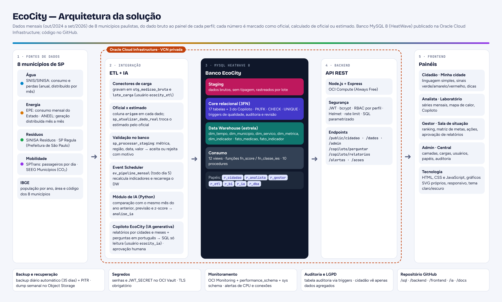

# EcoCity — Data Warehouse para Comunidades Sustentáveis

Projeto da **A3 de Banco de Dados** (Tema 18 · Cidades Inteligentes) — Gabriela Sant’Ana Merces Assis e Nicole Maranhão Assis · Profa. Cássia Assis.

**Problema:** os dados de água, energia, resíduos e mobilidade ficam em órgãos e sistemas diferentes, com formatos e frequências diferentes. Os gestores decidem com dados incompletos e não sabem quais ações deram resultado.

**Solução:** um banco MySQL em três camadas (staging → core 3FN → Data Warehouse em estrela) que integra os quatro serviços **mês a mês**, calcula 8 indicadores de sustentabilidade (ISO 37120 / ODS) e o **Índice EcoCity de Sustentabilidade (IES, 0–100)** por município e mês, gera alertas e análises de IA e liga cada ação ao seu resultado medido. Cada perfil tem a sua própria página: **Minha cidade** (cidadão), **Laboratório de dados** (analista), **Sala de situação** (gestor) e **Central do sistema** (admin).

**Confiança:** metas com dono (gestor propõe, analista credenciado dá parecer, outro gestor aprova, com vigência e histórico); análises dos analistas compartilhadas só depois de revisão por outra pessoa, com nível de confiança calculado pelo banco; analistas com credencial verificada pelo admin; login com senha forte (e chave individual do admin) e bloqueio após 5 erros.

**Diferencial — Copiloto EcoCity:** IA que escreve relatórios escolhendo cidades e intervalo de meses, e responde perguntas em português transformando-as em SQL somente leitura (usuário `ecocity_ia`). Os relatórios só são publicados depois que outra pessoa aprova.



## Estrutura do repositório

```
sql/        scripts do banco
  ecocity_banco_completo.sql      TUDO em um arquivo só (abrir no MySQL Workbench e clicar no raio)
  00_executar_tudo.sql            executa todos os scripts
  01_create_database_tabelas.sql  banco + 36 tabelas com constraints (Copiloto, metas, análises, credenciais, cadastro por perfil, login)
  02_indices.sql                  índices de desempenho
  03_funcoes_views.sql            fn_score, fn_classe_ies, fn_meta_vigente e 17 views
  04_triggers.sql                 qualidade, auditoria, alertas e revisão dos relatórios da IA
  05_procedures_eventos.sql       ETL, indicadores mensais, DW, resultados, Copiloto + evento mensal
  06_seguranca.sql                papéis (r_cidadao, r_analista, r_gestor, r_etl, r_bi, r_ia, r_dba) e usuários
  07_dados_teste.sql              dados mensais oficiais/calculados/estimados (gerado por gerar_dados_teste.py)
  07b_insights_ia.sql             saída do módulo de IA
  07c_copiloto_exemplos.sql       relatórios e perguntas de exemplo do Copiloto
  08_consultas_relatorios.sql     19 consultas (com filtro de cidades e meses)
  09_administracao_backup_monitoramento.sql
  10_testes_integridade.sql       26 testes que DEVEM falhar (FK, CHECK, triggers, Copiloto, metas, análises...)
  11_coleta_automatica.sql        robô de coleta: troca de estimado por oficial, registro de cada conferência das fontes (v17)
backend/    API REST (Node.js + Express + mysql2 + JWT), Copiloto, assistentes por perfil (src/assistentes/),
            linguagem simples (src/linguagem.js), fontes de cada número (src/fontes.js), páginas por perfil (src/perfis.js),
            robô de coleta das fontes oficiais (src/coleta/: conectores ANEEL, SPTrans, EPE, SEEG, SNIS, SINISA, IBGE) e IA de alertas (src/ia/alertas.js)
frontend/   site (index.html + assets/): página inicial, login, cadastro por perfil e uma área para cada perfil
            (cidadão: minha cidade, alertas, economize, fontes · analista: laboratório, assistente de relatórios, análises, metas
            · gestor: sala de situação, conselheiro IA, ações) + radar de riscos e administração. legado/ = site antigo
ia/         módulo de IA em Python (tendência mensal, previsão, mudança brusca)
dados_reais/ coleta oficial (coleta/ e coleta_mensal/) + planilha mensal
docs/       requisitos, DER, arquitetura, plano de segurança, cronograma, evidências
```

## Como executar localmente

Pré-requisitos: MySQL 8.0+, Node.js 20+, Python 3.10+.

```bash
# 1) Banco de dados
cd sql
mysql -u root -p --default-character-set=utf8mb4 < 00_executar_tudo.sql
mysql -u root -p -e "SET GLOBAL event_scheduler = ON;"

# 2) API + painel
cd ../backend
cp .env.example .env          # ajuste as credenciais
npm install
npm start                     # http://localhost:3000

# 3) (opcional) módulo de IA
cd ../ia
pip install pymysql numpy
python analise_ia.py --dry-run
```

Abra `http://localhost:3000`, escolha a porta do perfil e use um usuário de demonstração (senha `EcoCity@2026`). O cidadão entra sem login.

| Perfil | E-mail |
|---|---|
| Gestora | marina.duarte@ecocity.local |
| Analista | rafael.nunes@ecocity.local |
| Administrador | admin@ecocity.local |

**Cadastro por perfil:** o cidadão se cadastra com nome, e-mail, telefone (opcional) e cidade e entra na hora. Analista e gestor preenchem um cadastro completo (CPF, e-mail institucional, órgão, cargo, matrícula, formação, registro no conselho ou portaria de nomeação, documento de vínculo e justificativa) e só entram depois que o administrador aprova. O administrador não se cadastra pelo site: o DBA cria a conta com `CALL sp_criar_admin(...)` usando hashes gerados por `npm run hash -- "texto"`, e cada admin tem uma **chave individual** pedida no login. Chave do admin de demonstração: `ADM-EcoCity-2026`.

**Login:** e-mail e senha (sem código de celular). O administrador também digita a sua chave individual. Cinco erros seguidos bloqueiam a conta por 15 minutos; o banco registra cada tentativa.

Sem a API, o painel abre direto pelo arquivo `frontend/index.html` com um retrato do banco (`frontend/data.js`, gerado por `npm run snapshot`).

## Publicação na Oracle Cloud (OCI)

1. Criar uma **VCN** com sub-rede privada (banco) e pública (API).
2. Criar um **MySQL HeatWave DB System** (há opção Always Free) na sub-rede privada, com backup automático e PITR ligados.
3. Criar uma instância **Compute** (Ubuntu) na sub-rede pública; instalar Node.js e o cliente MySQL.
4. Executar os scripts: `mysql -h <IP_PRIVADO_HEATWAVE> -u admin -p < 00_executar_tudo.sql`.
5. Descomentar o `REQUIRE SSL` em `06_seguranca.sql`, guardar as senhas no **OCI Vault** e configurar `DB_SSL=true` no `.env`.
6. Rodar a API com `pm2` ou `systemd` e liberar a porta 443 (com proxy reverso Nginx + HTTPS).
7. Criar um bucket no **Object Storage** para os dumps semanais (`sql/09_...`).

## Endpoints da API

| Método | Rota | Perfil mínimo |
|---|---|---|
| POST | `/api/auth/login` (e-mail e senha; admin também envia a chave) | público |
| POST | `/api/auth/cadastro/cidadao` (cadastro simples) | público |
| POST | `/api/auth/cadastro/profissional` (analista ou gestor; fica em análise) | público |
| GET | `/api/public/resumo` (números e ranking da página inicial) | público |
| GET | `/api/minha-cidade` (números em linguagem simples + fonte de cada um; o cidadão recebe só a cidade dele) | cidadão |
| GET | `/api/riscos`, `/api/alertas` (IA; o cidadão recebe só a cidade dele) | cidadão |
| GET | `/api/fontes`, `/api/fontes/valor?municipio=&codigo=&mes=` (de onde vem cada número) | cidadão |
| GET | `/api/dicas/:tema` (economia de água, energia, lixo, transporte) | cidadão |
| POST | `/api/chat` (assistente: cidadão = dicas; analista = relatórios; gestor/admin = conselheiro) | cidadão |
| GET | `/api/cidadao` (painel geral das 8 cidades) | analista |
| GET | `/api/laboratorio` (série completa para o laboratório de dados) | analista |
| GET | `/api/publicas/analises`, `/api/publicas/analises/:id` | analista |
| GET | `/api/sala?municipio=` (sala de situação: prioridades, metas, ações) | gestor |
| GET/POST | `/api/admin/coleta` (status das fontes e "conferir agora", roda em segundo plano) | admin |
| GET | `/api/dados` | analista |
| GET | `/api/admin` | admin |
| GET | `/api/metas` | analista |
| POST | `/api/metas` (formulário "Nova meta") | gestor |
| POST | `/api/metas/:id/parecer` | analista com credencial verificada na área |
| POST | `/api/metas/:id/decisao` | gestor (diferente de quem propôs) |
| GET | `/api/analises`, `/api/analises/:id` | analista |
| POST/PUT | `/api/analises`, `/api/analises/:id` (rascunho) | analista (autor) |
| POST | `/api/analises/:id/enviar` | autor com credencial verificada |
| POST | `/api/analises/:id/revisao` | gestor ou analista da área de nível ≥ (nunca o autor) |
| POST | `/api/analises/:id/comentarios` | analista (só análises publicadas) |
| POST/GET | `/api/credenciais` | analista |
| PATCH | `/api/credenciais/:idUsuario` (verificar) | admin |
| PATCH | `/api/fontes/:id/confiabilidade` | admin |
| GET | `/api/cadastros`, PATCH `/api/cadastros/:idUsuario` (aprovar/recusar/suspender) | admin |
| GET | `/api/acessos` (tentativas de login) | admin |
| POST | `/api/copiloto/perguntar` | analista |
| POST | `/api/copiloto/relatorios` | analista |
| PATCH | `/api/copiloto/relatorios/:id` (aprovar/rejeitar) | gestor |
| PATCH | `/api/alertas/:id` | analista |
| POST | `/api/acoes`, `/api/acoes/:id/resultado` | gestor |

## Dados: oficial do mês, oficial do ano ou estimado

O banco cobre **8 municípios de São Paulo** com dados **mensais de jan/2023 a set/2026** (45 meses). Cada número usa o **último dado oficial publicado** pela sua fonte (coleta em 16/11/2026). Depois disso, o número é estimado a partir do último oficial, e o site mostra em cada cartão qual foi o último dado oficial.

| Dado | Último dado oficial | Origem no banco | Fonte |
|---|---|---|---|
| Energia solar (geração distribuída) | set/2026 | **Oficial do mês** | ANEEL Dados Abertos (base 16/11/2026) |
| Passageiros de ônibus de São Paulo | set/2026 | **Oficial do mês** | SPTrans (dia a dia somado por mês) |
| Resíduos de São Paulo | ago/2026 | **Oficial do ano/período** ÷ meses | SP Regula |
| Emissões do transporte | 2025 | **Oficial do ano** ÷ meses; 2026 estimado | SEEG Municípios |
| Água (consumo e perdas) | 2024 (Campinas: jun/2026) | **Oficial do ano** ÷ meses; depois estimado | SNIS/SINISA (Painel Saneamento); Campinas 2025-2026: SANASA |
| Resíduos das outras 7 cidades | 2024 | **Oficial do ano**; 2025-2026 estimados | SINISA |
| Energia consumida por cidade | 2024 (SP, Guarulhos e Campinas também 2023) | **Oficial do ano** ÷ meses pela variação da EPE; 2025-2026 estimados | Anuário de Energéticos por Município (SEMIL-SP) + EPE |
| Passageiros das outras 7 cidades | não existe | **Estimado** com a variação oficial da SPTrans | — |
| População | 2026 | Oficial (anual) | IBGE |

Total: **2.880 medições** — 405 oficiais do mês (14%), 1.240 oficiais do ano (43%) e 1.235 estimadas (43%). A coluna `dado.origem` guarda isso e `referencia_origem` explica cada número. Para trocar um estimado pelo oficial:

```sql
CALL sp_atualizar_dado_real('Campinas', 2024, 3, 'ENERGIA_CONSUMIDA', 512345, 'CPFL mar/2024');
SELECT * FROM vw_origem_dados;   -- mostra quanto ainda é estimado
```

Observação: Guarulhos e Campinas têm emissões de transporte por habitante altas porque o SEEG contabiliza o combustível de aviação dos aeroportos (Guarulhos e Viracopos) no município.

As regras de quem pode fazer o quê ficam no **banco** (procedures e triggers). A API repassa os pedidos e devolve a mensagem do banco quando uma regra bloqueia (HTTP 422).

## O que mudou na versão 21 (24/11/2026)

- **Posição entre as 8 cidades corrigida**: antes, por erro de arredondamento, uma cidade podia aparecer em "9º de 8". Agora a posição é calculada pelo valor exato e sempre fica entre 1º e 8º, igual em todas as telas.
- **Estimativas sem variação aleatória**: a estimativa só muda quando a série oficial usada muda. Números que vêm de um total **anual** (água, lixo, emissões) não mostram mais "melhorou/piorou" de um mês para o outro.
- **Dados oficiais sempre visíveis**: a Visão geral tem duas barras (os números do mês e o último dado oficial de cada número, com oficiais do mês e do ano); cada número mostra o último dado oficial publicado (valor, mês e fonte), e os gráficos trazem esse oficial mesmo quando ele é mais antigo que os meses exibidos.
- **Sem "nota 0–100"**: as telas de analista e gestor usam metas cumpridas, quanto falta para a meta e a posição entre as cidades.
- **Metas escritas e realistas**: cada meta tem a frase da meta, ponto de partida, prazo e os projetos para chegar lá (tabela `meta`: colunas novas `descricao`, `linha_base`, `prazo`, `como_atingir`). O analista abre os detalhes antes de dar o parecer.
- **Cadastro de gestor e analista mais curto**: nome, e-mail institucional, órgão, cargo e cidade (gestor). CPF, telefone, matrícula, formação e documentos passaram a ser opcionais.

## Publicar na Aiven (banco) + Render (site)

Passo a passo em [`PUBLICAR_NA_AIVEN.md`](PUBLICAR_NA_AIVEN.md). Use o script `sql/ecocity_banco_aiven.sql` (versão para banco gerenciado: as permissões dos papéis também vão direto para cada usuário) e o `render.yaml` da raiz.
