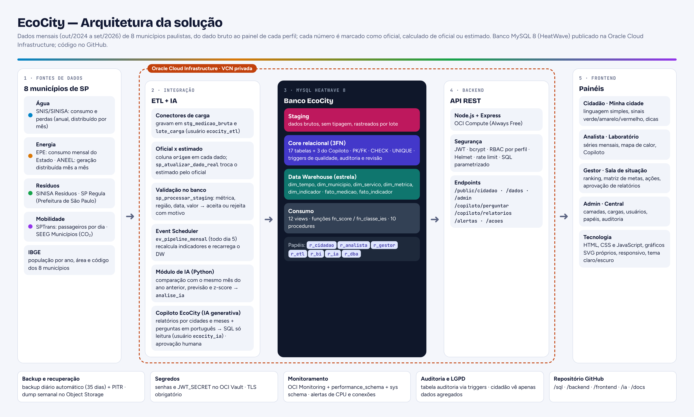

# Arquitetura de dados — EcoCity

1. **Fontes**: IBGE, ANEEL, EPE, SPTrans, SNIS/SINISA, SEEG e Prefeitura de SP, em APIs, planilhas, arquivos parquet, PDFs e páginas web. Grão mensal (jan/2023 a dez/2024, os anos com todas as fontes oficiais publicadas).
2. **Integração (ETL)**: os dados chegam crus em `stg_medicao_bruta`, cada envio vira um `lote_carga`. A procedure `sp_processar_staging` valida (métrica, município, data, valor, serviço da fonte), carrega em `dado` e registra o motivo de cada rejeição.
3. **Core relacional (3FN)**: tabelas normalizadas com integridade referencial, triggers de qualidade e auditoria; cada medição mensal tem origem REAL, DERIVADO ou ESTIMADO.
4. **Data Warehouse (estrela)**: `sp_carga_dw` atualiza 5 dimensões (SCD tipo 1) e recarrega 2 fatos por mês; o evento `ev_pipeline_mensal` roda todo dia 5.
5. **IA**: `ia/analise_ia.py` compara cada mês com o mesmo mês do ano anterior, projeta quando a meta será atingida e detecta mudanças bruscas, gravando em `analise_ia` (status `NOVA`). O **Copiloto EcoCity** escreve relatórios (cidades e meses escolhidos) e responde perguntas em português com SQL somente leitura (`ecocity_ia`); relatórios só são publicados após aprovação humana.
6. **API**: Node.js + Express, JWT, controle por perfil e consultas parametrizadas; usa o usuário `ecocity_api` (menor privilégio).
7. **Frontend**: uma página diferente por perfil — Minha cidade (cidadão), Laboratório de dados (analista), Sala de situação (gestor) e Central do sistema (admin).

Infraestrutura: Oracle Cloud Infrastructure — MySQL HeatWave (banco), Compute (API e painel), Object Storage (backups), Vault (segredos), Monitoring (alarmes). Código versionado no GitHub.

## Diagramas

- `diagramas/der_core_3fn.png` — DER da camada relacional
- `diagramas/der_dw_estrela.png` — modelo estrela do DW
- Os DER são gerados do banco real por `diagramas/gerar_der.py`.
